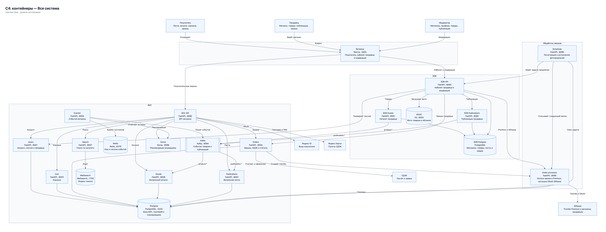

# Handmade Ecom

Маркетплейс товаров ручной работы. В этом репозитории собраны витрина, сервисы покупателя, кабинет продавца, модерация, обработка платежей и планировщик продления подписки.

## Состав репозитория

| Директория | Что внутри |
| --- | --- |
| `HandmadeGoodsPlatform/ecom-platform` | Веб-приложение на Next.js (`:3000`): витрина покупателя, кабинет продавца (`/seller`) и страницы модерации (`/moderation`). |
| `ecom-platform-B2C` | B2C BFF (`:8080`) и микросервисы покупательской стороны: `users` (`:8001`), `publications` (`:8002`), `cart` (`:8003`), `orders` (`:8004`), `eventer` (`:8005`), `goods` (`:8006`), `search` (`:8007`), а также `postgres`, `redis`, `kafka`, `meilisearch` и `gorse` (`:8088`). |
| `b2b_back` | Кабинет продавца и модерация: `b2b` (`:8090`), каталог продавца `b2b-goods` (`:8081`), публикации продавца `b2b-publications` (`:8082`), своя база `b2b-postgres` и S3-хранилище `minio` (`:9000`). |
| `sem-ecom-platform` | Сервис `order-processor` (`:8095`): оплата заказов (в локальном режиме — встроенная заглушка ЮKassa и OAuth-привязка магазина) и оплата подписки Premium через тестовый магазин ЮKassa. |
| `scheduler` | Сервис периодических задач (`:8096`) со своей БД `ecom_scheduler`: регистрирует задачи автопродления Premium из B2B и списывает следующий месяц по сохранённому способу оплаты. |
| `integration` | Общий `compose.yaml`, который связывает B2C, B2B, платежи и планировщик в единый контур, а также артефакты тестирования и архитектурные схемы. |

## Архитектура (C4, уровень контейнеров)

Исходники схем в Mermaid: [`integration/c4-containers.md`](integration/c4-containers.md), версия для печати: [`integration/c4-containers.pdf`](integration/c4-containers.pdf).

- Вся система — [`integration/c4-system.png`](integration/c4-system.png)
- Контур B2C — [`integration/c4-b2c.png`](integration/c4-b2c.png)
- Контур B2B и модерация — [`integration/c4-b2b.png`](integration/c4-b2b.png)
- Обработка заказов и автопродление Premium — [`integration/c4-orders.png`](integration/c4-orders.png)



## Запуск

Требуются Docker, Docker Compose и Node.js 20+.

### 1. Конфигурация окружения

Скопируйте пример переменных для B2C/общего контура и при необходимости заполните ключи интеграций (Яндекс ID, СДЭК, тестовый магазин ЮKassa, Яндекс Карты):

```bash
cp ecom-platform-B2C/.env.example ecom-platform-B2C/.env
cp HandmadeGoodsPlatform/ecom-platform/.env.example HandmadeGoodsPlatform/ecom-platform/.env.local
```

### 2. Бэкенд и инфраструктура

Из корня репозитория поднимается весь серверный контур (B2C + B2B + платежи + планировщик):

```bash
docker compose \
  --env-file ecom-platform-B2C/.env \
  -f ecom-platform-B2C/docker-compose.yml \
  -f integration/compose.yaml \
  up -d --build
```

### 3. Фронтенд

```bash
cd HandmadeGoodsPlatform/ecom-platform
npm install
npm run dev
```

Приложение откроется на [http://localhost:3000](http://localhost:3000).

## Основные адреса и входы

| Раздел | Адрес | Примечание |
| --- | --- | --- |
| Витрина покупателя | `http://localhost:3000` | Вход через Яндекс ID |
| Кабинет продавца | `http://localhost:3000/seller` | Доступен после одобрения заявки «Стать продавцом» |
| Модерация | `http://localhost:3000/moderation/login` | Локальный вход: `moderator` / `moderator-local` |
| Админ-переопределение статусов заказов | `http://localhost:3000/admin/orders` | Для проверки статусов доставки на витрине и в кабинете продавца |
| B2C API (Swagger) | `http://localhost:8080/docs` | BFF покупателя |
| B2B API (Swagger) | `http://localhost:8090/docs` | Фасад продавца и модерации |
| Order processor | `http://localhost:8095/docs` | Платежи заказов, Premium и локальный OAuth ЮKassa |
| Scheduler | `http://localhost:8096/readyz` | Планировщик автосписаний Premium |

## Ключевые сценарии

- **Регистрация магазина и модерация.** Покупатель подаёт заявку с реквизитами (физлицо/самозанятый/ИП или юрлицо) и аватаром. Заявка, изменения профиля магазина, новые товары, правки контента товаров и публикации проходят через `/moderation` с возможностью отклонения по причине и отката черновика продавцом.
- **Изображения.** Все изображения продавца (аватар магазина, фото товаров, обложки постов) загружаются файлами в S3 (`minio`).
- **Наличие и способы доставки.** Смена только способов доставки, остатка (`inStock`) или режима продажи («В наличии» / «По сделке») применяется сразу без повторной модерации. Нулевой остаток в режиме «В наличии» отображается на витрине как «Нет в наличии».
- **Оформление и получение заказа.** Создание заказа сразу уменьшает остаток в каталоге продавца и на витрине. Для самовывоза продавец переводит заказ в «Доставлен» («Готов к выдаче»), покупатель видит 6-значный код и называет его продавцу для завершения заказа. Для СДЭК расчёт стоимости, создание и отмена заявки идут через API СДЭК.
- **Подписка Premium.** Магазин подключает ЮKassa по OAuth (локально работает встроенная заглушка на `:8095`). Первая оплата Premium проходит через тестовый магазин ЮKassa с сохранением способа оплаты (`5555 5555 5555 4444`), далее `scheduler` раз в месяц продлевает подписку, пока продавец не отключит автопродление в разделе «Тарифы».
