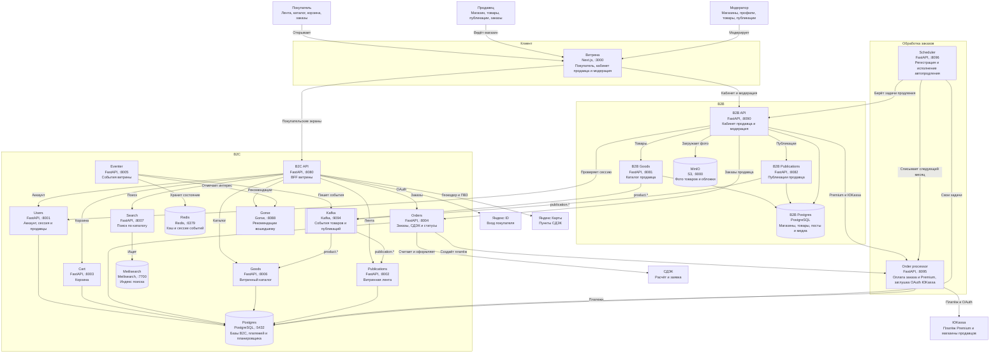
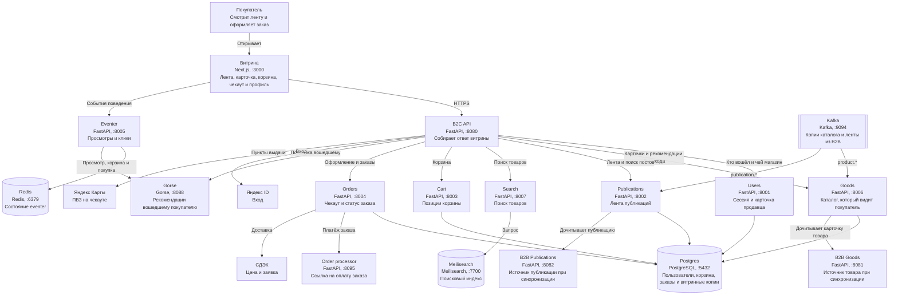
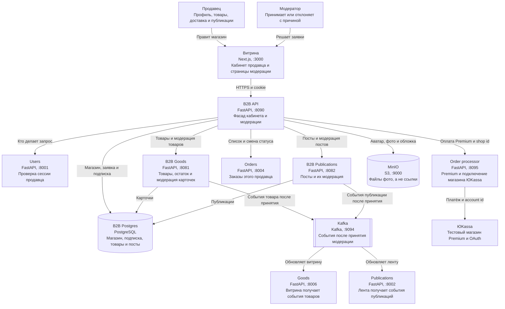
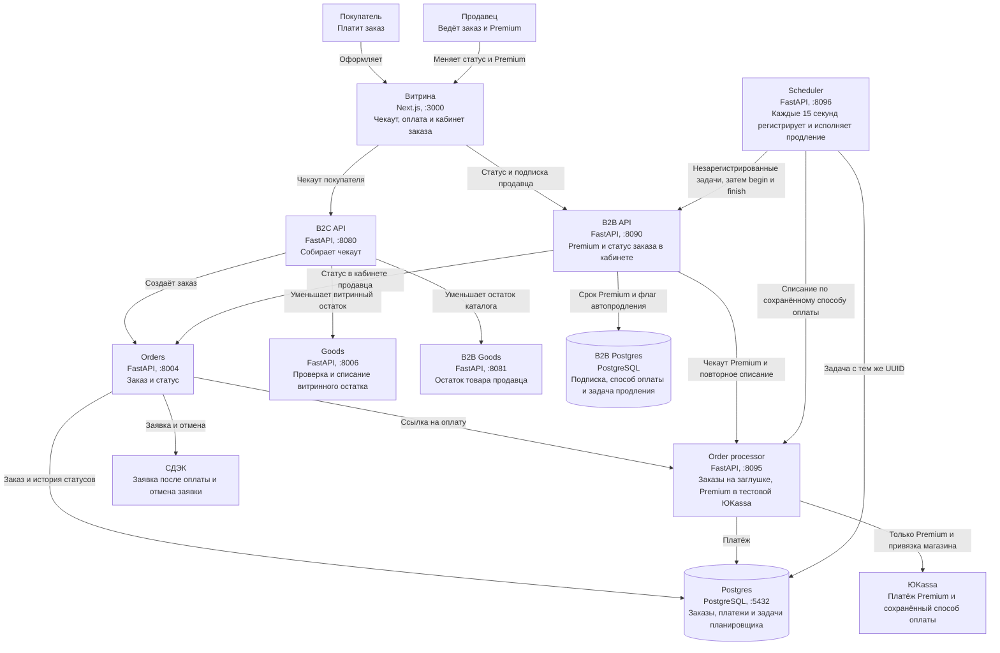

# C4: контейнеры

Один и тот же сервис повторяется на разных схемах, если он участвует в сценарии. Базы B2C, платежей и планировщика лежат в одном Postgres. У B2B своя база.

## Вся система

## B2C

## B2B

## Обработка заказов

